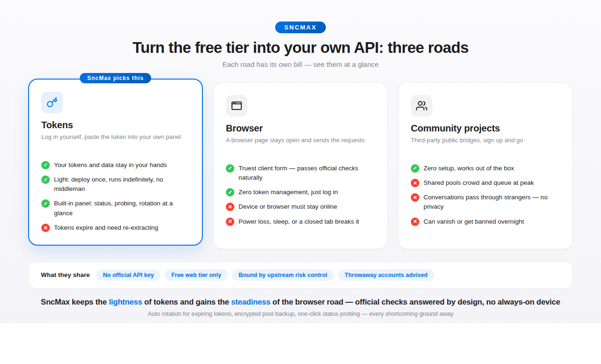

<div align="center">

# SncMax

**Self-hosted DeepSeek gateway that speaks the OpenAI & Anthropic API standards.**

[](LICENSE)
[](https://github.com/1515asd/SncMax/commits/main)
[](https://github.com/1515asd/SncMax/stargazers)


Point any OpenAI/Anthropic-compatible client at this server and it just works —
streaming, tool calling, and long-context session management out of the box.

**Works with** · Claude Code · Cline · LibreChat · Open WebUI · LobeChat · Cherry Studio · Dify · anything OpenAI/Anthropic-compatible

[English](README.md) | [简体中文](README.zh-CN.md)

</div>

> **Snc1 · Major update**: after half a day of research, the previously abstract problem finally became concrete — one turn of thinking, and **the sending side moved**. The long list of login, disconnect, and empty-reply issues is resolved at the method level, instead of being patched one by one. The implementation stays private; usage stays the same: log in via your browser, grab the token, paste it into the dashboard.

**What did the new approach buy?** In the past, every upstream tremor — captchas, device fingerprints, protocol field changes — meant an emergency release. Under the new approach those verifications happen where they were always meant to happen, so **this project barely needs to deal with them anymore**: whether already shipped or added in the future, most new verifications and policy changes won't reach this side, and the release cadence drops accordingly.

## What Snc1 brings

- **A new approach** — the sender has been replaced outright, eliminating problems at the source; the old "upstream changes, everything breaks" patch cycle is gone
- **Full-speed burst** — measured ~**63%** reduction in the server's own overhead (7.0ms → 2.6ms per turn); upstream latency is upstream's business, ours is now at the floor
- **A brand-new panel** — redesigned after Apple's Human Interface Guidelines: graceful low-cost animations, 5-day remember-me, multi-Key management, mobile layout; the old panel is retired
- **Multi-Key** — add multiple client Keys from the panel, toggle or delete anytime, the default Key always works
- **Less chasing, fewer updates** — captchas, device fingerprints, and policy changes official adds in the future barely reach this side anymore; the repo no longer needs to release with every upstream move

## What is this

Based on upstream [`AmanCode22/deeperseeker`](https://github.com/AmanCode22/deeperseeker) (MIT), this project wraps DeepSeek's free web tier into a standard API — no official API key needed — exposing both OpenAI Chat Completions and Anthropic Messages. This repo maintains a long-term self-hosted deployment on free hosting platforms.

## Three approaches, three trade-offs

Free-tier setups come down to three roads — **tokens** (log in yourself, paste into your own panel: your data, your control, but tokens need re-extracting), **browser** (a page stays open as the sender: the truest form, but your device must be always-on), and **community projects** (third-party public bridges: zero setup, but shared pools crowd, privacy is out of your hands, and they can vanish anytime). What they share: no official API key, all ride the free web tier, all bound by upstream risk control, and all deserve a throwaway account.



## Where to follow updates

- **Dev line (main)**: [commit history](https://github.com/1515asd/SncMax/commits/main)
- **English stable line (english)**: [commit history](https://github.com/1515asd/SncMax/commits/english)

| Version | Date | Notes |
|---|---|---|
| **Snc1** | 11-08 | **Method + panel generational change (current).** Sender replaced (details private, see note above); full-chain speedup (own overhead -63%); panel rebuilt after Apple HIG: animations, 5-day remember-me, multi-Key, usage charts, mobile cards; fingerprint content demoted to appendix (optional) |
| v90.5 | 11-08 | Preceding updates: performance close-out (7.0→2.6ms), super panel (remember-me / multi-Key / new UI) |
| v90.3 | 11-07 | Thinking + body output restored: official now splits a thinking reply into fragments plus a whole-packet snapshot the old parser ignored, swallowing the body into the thinking box. `DEEPSEEKER_FRAGMENT_FIX=0` reverts |
| v90.2 | 11-07 | Follow-up turns must carry the `shumei_device_id` key (missing = instant empty reply); empty answers no longer cached by the duplicate guard |
| v90.1 | 11-07 | Device-fingerprint bookkeeping (panel-layer only); Quick-Instructions tutorial replaced by the verified browser-login + bookmarklet route |
| v90.0 | 11-07 | Usage-model generational change (rebuilt on v89.7): in-bridge login and hif risk-control headers removed; "user-device birth" model |
| v89.7 | 11-05 | Mute-detection fix (nested mute envelope no longer missed); per-token "Check status" button in the pool |
| v89.6 | 11-05 | Two NameError-always-500 endpoints fixed; panel status system rebuilt (quarantine reasons persisted, five states) |
| v89.5 | 11-05 | Bare-JSON tool calls deterministically auto-repaired (four gates, zero extra round-trips) |
| v89.4 | 11-05 | Bare-JSON tool-call self-healing (diagnostic continuation; normal replies byte-identical) |
| v89.3 | 11-04 | Zero false quarantines: auth-worded soft evidence no longer punished once, 3-strike threshold, success resets |
| v89.2 | 11-04 | Duplicate-call gate wording reduced to plain factual statements |
| v89 | 11-04 | Duplicate-call gate (intervenes only while a loop is actually happening) |
| v88 | 11-04 | Ported upstream PR #94 hardening: business-level errors classified and trigger rotation |
| v87 | 11-04 | Fixed the "conversation amnesia" chain (stale PoW credentials → false empty-stream → session-map poisoning) |
| v86 | 11-01 | Admin panel redesign with deep health checks; Docker deployment files (PR #1, thanks @anch665) |
| v85 | 11-01 | Stable release for the 10-31 protocol change: native message numbering, empty-stream auto-continuation, tool-marker leak blocking |
| v82–v84 | 10-31 ~ 11-01 | Emergency fixes for the protocol change (test builds) |

## What this fork adds

The basics — free web tier to standard API, multi-account rotation, long-context rolling continuation, built-in panel — are inherited from upstream. Only the increments are listed, effects only, no recipes:

- **Half-finished answers auto-continue** — unattended long tasks survive upstream stream cuts; already-generated text is kept
- **Tool-call fragments never leak into the body** — 16 known malformed tool-marker shapes are intercepted before output
- **Token pool survives container rebuilds** — encrypted periodic backup plus automatic restore on empty start
- **A gate against duplicate calls** — factual annotations injected only while a real loop is happening; normal requests untouched
- **Panel states in plain words** — every token state explained, the "Restore" button is always safe
- **Two language lines** — `main` ships Chinese docs; [`english`](https://github.com/1515asd/SncMax/tree/english) is fully English with identical code

## Recovering old conversations (started before the protocol change)

Sessions started before 2026-10-31 had their server-side state invalidated by the protocol change. **History is not lost** — two recovery paths:

1. **Wait**: once the old session expires (usually hours), send a new message; the client re-sends full history automatically and memory rebuilds
2. **Impatient**: log into the DeepSeek web app, delete that conversation, then send a message to rebuild

## Quick start

**First time? Read the [usage guide](docs/GUIDE.md)** — plain-language install, panel, concepts, and FAQ. Chinese version: [docs/GUIDE.zh-CN.md](docs/GUIDE.zh-CN.md).

Local run:

```bash
git clone https://github.com/1515asd/SncMax.git
cd SncMax
python3 -m venv env && source env/bin/activate
pip install -r requirements.txt
cp .env.example .env   # fill in config before starting
python3 app.py
```

Docker / Podman:

```bash
cp .env.example .env
docker compose up -d          # or podman-compose up -d
```

Panel: `http://localhost:4000/`

> Free hosting platforms (Pterodactyl family): the panel injects `SERVER_PORT`, so start with `PORT=$SERVER_PORT python app.py`; the `wasm/` directory must be deployed in full; point `DB_PATH` at a persistent volume to keep the token pool across rebuilds.

## Configuration (`.env`)

| Variable | Meaning | Default |
|---|---|---|
| `DEEPSEEKER_API_KEY` | Bearer key required by the API (more can be added from the panel) | `dseeker` |
| `DEEPSEEKER_ADMIN_USER` | Panel username | `admin` |
| `DEEPSEEKER_ADMIN_PASSWORD` | Panel password | `admin` |
| `HOST` | Listen address (`127.0.0.1` local only, `0.0.0.0` open) | `127.0.0.1` |
| `PORT` | Server port | `4000` |
| `DEEPSEEKER_MAX_HISTORY_TOKENS` | History injection cap for the first message | `24000` |
| `DEEPSEEKER_MAX_TOOL_RESULT_TOKENS` | Tool-result injection cap | `12000` |
| `DEEPSEEKER_MEMORY_LIMIT_TOKENS` | Memory cap before rolling continuation | `393228` |
| `DEEPSEEKER_MAX_OUTPUT_TOKENS` | Per-response output cap | `8192` |
| `DEEPSEEKER_MAX_SUMMARY_TOKENS` | Handoff-summary budget | `4096` |

## Getting a token

1. Log into `chat.deepseek.com` in an incognito window (new devices may require an email OTP — that's the official flow)
2. Extract the token (pick one):
   - **Desktop / Android (with dev tools)**: run `JSON.parse(localStorage.getItem("userToken")).value` in the F12 console
   - **iPhone / iPad (Safari bookmarklet)**: Safari cannot run `javascript:` directly — bookmark any page, edit the bookmark, replace its URL with the snippet below, then tap it while on the logged-in `chat.deepseek.com` page:

   ```javascript
   javascript:(function(){var t='';try{var r=localStorage.getItem('userToken');if(r){try{t=JSON.parse(r).value||r;}catch(e){t=r;}}}catch(e){alert('Read failed: '+e.message);return;}if(!t||t.length<20){alert('No userToken found.');return;}var a=document.createElement('textarea');a.value=t;a.style.cssText='position:fixed;left:-9999px';document.body.appendChild(a);a.select();a.setSelectionRange(0,999999);document.execCommand('copy');a.remove();alert('Copied. length '+t.length+'\n'+t.substring(0,12)+'...');})();
   ```

3. Paste the token into the panel (`/dashboard`), close the incognito window

## Token lifetime & panel states (plain words)

**When do tokens expire?** Whenever DeepSeek's server decides — unknowable from here. Expired tokens surface as client `401` (incl. `INVALID_TOKEN`) or `503 No tokens available`, with the panel showing "likely expired". **Extract a new token, add it, delete the old one** — the "Restore" button won't help; a dead token is dead.

**What do panel states mean?**

| State | Meaning | What to do |
|---|---|---|
| 🟢 Normal | Working | Nothing |
| 🔵 Cooling | Rate-limited, resting | Recovers automatically |
| 🟠 Confirmed muted | DeepSeek explicitly reported the account muted (with end time) | Wait it out, then "Restore" |
| 🟠 Likely muted | Account suspected temporarily restricted | "Restore" after the ban lifts; if the web app chats fine, it was a false positive — just "Restore" |
| 🔴 Likely expired | Token dead (expired or logged out) | Extract a new one, add, delete the old; "Restore" won't help |
| 🔴 Quarantined | Left rotation for another reason (see the note column) | "Restore" once upstream is confirmed healthy |

**Can't tell expired from muted?** Use the "**Check status**" button — it asks DeepSeek directly about each token (normal / muted until X / revoked) and auto-quarantines confirmed mutes. Or log into `chat.deepseek.com`: re-login prompt = expired; mute popup = muted; chatting fine = false positive. The "Restore" button is always safe — a truly dead token gets re-quarantined automatically.

**Prompt-enhance switch** (panel "Feature switches"): with `reasoning_effort=max`-style requests, an extra "think slowly, verify from angles" instruction is appended — deeper answers, slightly slower, more tokens. Toggleable anytime; off = byte-identical to the old behavior.

## API endpoints

- **OpenAI-compatible**: `http://localhost:4000/v1` — `/v1/chat/completions` (streaming/non-streaming), `/v1/responses`, `/v1/models`, `/v1/files`
- **Anthropic-compatible**: `http://localhost:4000` — `/v1/messages`, `/v1/files/upload`
- **Model**: `v4.1flash` (the single default, native vision). Any `model` value is normalized to it; `/v1/models` also lists `anthropic/claude-v4.1flash` for Claude Desktop discovery

## Disclaimer

⚠️ Automated use violates DeepSeek's terms of service. This project is not affiliated with DeepSeek. Use a dedicated throwaway account, never your personal one; accounts may be banned at any time, at your own risk. Don't abuse it, personal use only.

## License

MIT — see [LICENSE](LICENSE). Copyright belongs to upstream author AmanCode22; this fork's improvements are released under the same license.

## Appendix · About the device fingerprint (optional, display only)

Upstream's **login endpoint** enforces device-fingerprint validation for the android-protocol login (only android-native SDK output is accepted; short browser-SDK ids are rejected) — this only affects which login route you pick, not how this project runs. The fingerprint field in the panel is **for filing/display only**: it helps you tell tokens apart and is never sent with requests. **Leaving it empty is perfectly fine; there is no official enforcement against it. Feel free to skip it.**
