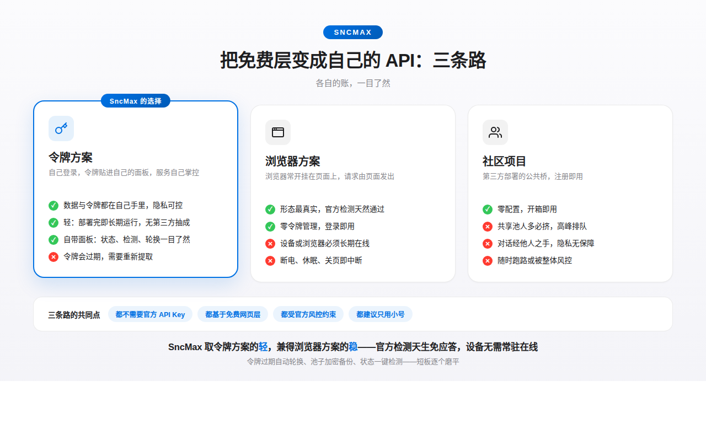

<div align="center">

# SncMax

**自托管的 DeepSeek 网关，原生支持 OpenAI 与 Anthropic API 标准。**

[](LICENSE)
[](https://github.com/1515asd/deeperseekerSncMax/commits/main)
[](https://github.com/1515asd/deeperseekerSncMax/stargazers)


把任何兼容 OpenAI / Anthropic 的客户端指向本服务即可使用——流式输出、工具调用、超长上下文会话管理开箱即用。

**适配客户端** · Claude Code · Cline · LibreChat · Open WebUI · LobeChat · Cherry Studio · Dify · 及一切 OpenAI/Anthropic 兼容客户端

[English](README.md) | [简体中文](README.zh-CN.md)

</div>

> **Snc1 · 重磅更新**：经过半天的研究，此前的抽象难题被彻底具象化——思路一转，**发送这件事换了位置**。困扰已久的登录、掉线、空回复等问题在方法层面就已消除，不再需要追着协议改动一个个打补丁。细节这里暂不展开——项目代码本身就是最完整的说明，感兴趣的可以直接读源码；整套链路目前还比较复杂，三言两语讲不清，等稳定下来再补文档。使用方式一切如常：浏览器登录、取令牌、贴进面板。

**换思路换来了什么？** 过去官方一有风吹草动——人机验证、设备指纹、协议字段调整——桥就得连夜跟进发版。新思路下，这些验证发生在它本来就该发生的地方，**本项目几乎不再需要应对它们**：无论是已出台的还是将来新增的验证与政策变更，大概率轮不到这边适配，更新频率也随之大幅下降。

## Snc1 带来了什么

- **全新思路** — 从源头解决问题；此前大量"上游一改就坏"的补丁场景不再出现
- **全速迸发** — 服务端自有开销实测降低约 **63%**（7.0ms → 2.6ms/轮）；上游快慢不影响你这边，本机开销已压到极限
- **全新面板** — 参照 Apple 人机界面规范重新设计：优雅的低开销动画、5 天免登录、多 Key 管理、移动端适配，旧版面板整体废弃
- **多 Key** — 面板可添加多个客户端 Key，随时启停、即加即用，默认 Key 永远有效
- **少追赶，少更新** — 官方新增的人机验证、设备指纹、政策变更，在新思路下几乎无需应对，仓库不再需要跟着官方频繁发版

## 这是什么

本项目基于上游 [`AmanCode22/deeperseeker`](https://github.com/AmanCode22/deeperseeker)（MIT），把 DeepSeek 网页免费层包装成标准 API：无需官方 API Key，同时提供 OpenAI Chat Completions 与 Anthropic Messages 两套接口。本仓库在其基础上长期维护免费层平台的自托管部署。

## 三种方案的取舍

免费层方案不外乎三条路——**令牌方案**（自己登录、令牌贴进自己的面板：数据在自己手里，代价是令牌需自行更换）、**浏览器方案**（页面常开当发送者：形态最真，代价是设备必须常驻在线）、**社区项目**（第三方公共桥：零配置，代价是共享池拥挤、隐私无保障、随时可能停摆）。三条路的共同点：都不需要官方 API Key、都基于免费网页层、都受官方风控约束、都建议只用小号。



## 更新在哪看

- **开发线（main）**：[提交历史](https://github.com/1515asd/deeperseekerSncMax/commits/main)
- **英文稳定线（english）**：[提交历史](https://github.com/1515asd/deeperseekerSncMax/commits/english)

| 版本 | 日期 | 内容 |
|---|---|---|
| **Snc1** | 11-08 | **方法换代 + 面板换代（当前版本）**。发送者替换（细节暂不展开，项目代码本身就是最完整的说明，感兴趣的可以直接读源码；整套链路目前还比较复杂，三言两语讲不清，等稳定下来再补文档）；服务端全链路提速（自有开销 -63%）；面板按 Apple HIG 全面重做：动画、记住登录 5 天、多 Key 管理、用量图表、移动端卡片化；指纹相关内容降级为附录（可不填），并收编了此前测试期的性能收口与超级面板等前置更新 |
| v90.3 | 11-07 | 恢复思考 + 正文正常输出：官方把带思考的回复拆成片段并甩一个整包快照，旧解析不认导致正文被吞进思考盒。`DEEPSEEKER_FRAGMENT_FIX=0` 可回退旧解析 |
| v90.2 | 11-07 | 续聊请求补齐 `shumei_device_id` 键（缺失即秒回空）；空内容不再进入重复消息缓存 |
| v90.1 | 11-07 | 设备指纹簿记（纯面板层备档）；快捷指令教程替换为实测可跑通的浏览器登录 + 书签路线 |
| v90.0 | 11-07 | 使用模型换代（基于 v89.7 重建）：桥内登录与 hif 风控头整套移除，改为"用户设备出生"模型 |
| v89.7 | 11-05 | 禁言检测修复（嵌套信封里的禁言报文不再漏判），令牌池新增「检测令牌」按钮 |
| v89.6 | 11-05 | 恢复端点两个 NameError 必 500 修复；面板状态体系重做（隔离原因落库、五态五色） |
| v89.5 | 11-05 | 裸 JSON 工具调用确定性自动修复（四道闸门全过时零额外往返） |
| v89.4 | 11-05 | 裸 JSON 工具调用自愈（诊断续写，正常回复逐字节不变） |
| v89.3 | 11-04 | 隔离零误判：鉴权措辞软证据单次不再惩罚，连续 3 次才隔离，成功一轮清零 |
| v89.2 | 11-04 | 重复调用闸门文案改为纯事实陈述 |
| v89 | 11-04 | 重复调用闸门（死循环发生时才介入） |
| v88 | 11-04 | 移植上游 PR #94 加固：业务级错误正确分类并触发令牌轮转 |
| v87 | 11-04 | 修复「对话失忆」链（PoW 凭证过期 → 误判空流 → 会话映射中毒） |
| v86 | 11-01 | 管理面板重新设计，集成深度健康检查；新增 Docker 部署文件（PR #1，感谢 @anch665） |
| v85 | 11-01 | 10-31 协议变更的稳定版：原生消息编号协议、空流自动续写、工具标记泄露拦截 |
| v82–v84 | 10-31 ~ 11-01 | 协议变更当日的紧急修复（测试版） |

## 我们在原版之上做了什么

基础能力——免费网页层转标准 API、多账号轮转、长上下文滚动接续、内置面板——都继承自上游。下面只列此仓库的增量，只讲效果，不讲做法：

- **回答写到一半断了，自动接上** — 无人值守的长任务不会因断流整段报废，已生成的部分原样保留
- **工具调用乱码进不了正文** — 模型偶尔吐出的残缺工具标记，16 种已知形态都会在进入输出前被拦下
- **令牌池不怕容器重建** — 免费平台说重建就重建，令牌表定时加密备份、启动时发现池子空了自动恢复
- **重复调用有闸门** — 同一命令被原样重发时自动注入事实备注，死循环在发生时才被介入，正常请求零打扰
- **面板状态说人话** — 每个令牌的正常 / 冷却 / 禁言 / 过期状态配大白话说明，「恢复」按钮永远安全
- **两条语言线** — `main` 附中文文档，[`english`](https://github.com/1515asd/deeperseekerSncMax/tree/english) 线全英文，代码一致

## 旧对话恢复（协议变更前开始的对话）

2026-10-31 之前的旧会话，其服务端状态已被协议变更作废。历史记录**没有丢**，两种恢复方式：

1. **等待**：旧会话过期后（通常若干小时）重新发消息，客户端会自动全量重发历史，记忆自动重建
2. **等不及就去 DeepSeek 官网**：登录网页版，找到那个会话直接删除，再发消息即可重建

## 快速开始

**第一次用？先读[使用指南（中文）](docs/GUIDE.zh-CN.md)**——大白话讲清楚安装、面板、原理与常见问题。英文版见 [docs/GUIDE.md](docs/GUIDE.md)。

本地运行：

```bash
git clone https://github.com/1515asd/deeperseekerSncMax.git
cd SncMax
python3 -m venv env && source env/bin/activate
pip install -r requirements.txt
cp .env.example .env   # 填好配置再启动
python3 app.py
```

Docker / Podman：

```bash
cp .env.example .env
docker compose up -d          # 或 podman-compose up -d
```

面板地址：`http://localhost:4000/`

> 免费托管平台（Pterodactyl 系）注意：面板注入的是 `SERVER_PORT`，启动命令用 `PORT=$SERVER_PORT python app.py`；`wasm/` 目录必须完整部署；`DB_PATH` 指到持久卷可跨容器重建保留令牌池。

## 配置（`.env`）

| 变量 | 说明 | 默认值 |
|---|---|---|
| `DEEPSEEKER_API_KEY` | 访问 API 所需的 Bearer 密钥（面板可另加多个） | `dseeker` |
| `DEEPSEEKER_ADMIN_USER` | 面板登录用户名 | `admin` |
| `DEEPSEEKER_ADMIN_PASSWORD` | 面板登录密码 | `admin` |
| `HOST` | 监听地址（`127.0.0.1` 仅本机，`0.0.0.0` 对外） | `127.0.0.1` |
| `PORT` | 服务端口 | `4000` |
| `DEEPSEEKER_MAX_HISTORY_TOKENS` | 首条消息注入历史上限 | `24000` |
| `DEEPSEEKER_MAX_TOOL_RESULT_TOKENS` | 工具结果注入上限 | `12000` |
| `DEEPSEEKER_MEMORY_LIMIT_TOKENS` | 触发滚动接续的记忆上限 | `393228` |
| `DEEPSEEKER_MAX_OUTPUT_TOKENS` | 单次响应输出上限 | `8192` |
| `DEEPSEEKER_MAX_SUMMARY_TOKENS` | 交接摘要预算 | `4096` |

## 获取令牌

1. 开无痕窗口登录 `chat.deepseek.com`（新设备可能要求邮箱验证码，属官方流程）
2. 提取令牌（按设备二选一）：
   - **桌面 / Android（有开发者工具）**：F12 控制台执行 `JSON.parse(localStorage.getItem("userToken")).value`
   - **iPhone / iPad（Safari 书签）**：Safari 无法直接跑 `javascript:`，先收藏任意页面，编辑该书签、把网址替换为下面的代码，然后在已登录的 `chat.deepseek.com` 页面点该书签，令牌自动复制：

   ```javascript
   javascript:(function(){var t='';try{var r=localStorage.getItem('userToken');if(r){try{t=JSON.parse(r).value||r;}catch(e){t=r;}}}catch(e){alert('Read failed: '+e.message);return;}if(!t||t.length<20){alert('No userToken found.');return;}var a=document.createElement('textarea');a.value=t;a.style.cssText='position:fixed;left:-9999px';document.body.appendChild(a);a.select();a.setSelectionRange(0,999999);document.execCommand('copy');a.remove();alert('Copied. length '+t.length+'\n'+t.substring(0,12)+'...');})();
   ```

3. 把令牌粘贴进面板（`/dashboard`），关掉无痕窗口

## 令牌有效期与面板状态（人话版）

**令牌什么时候会过期？** 不固定，由 DeepSeek 服务端决定，这边无法预知。过期后客户端会报 `401`（含 `INVALID_TOKEN`）或 `503 No tokens available`，面板状态列会显示「疑似过期」。此时**重新提取一个新令牌、添加进面板、删掉旧令牌**即可恢复，点「恢复」按钮没用——令牌死了就是死了。

**面板状态是什么意思？**

| 状态 | 意思 | 你需要做什么 |
|---|---|---|
| 🟢 正常 | 能正常干活 | 什么都不用做 |
| 🔵 限速冷却 | 请求太频繁，临时休息 | 自动恢复，不用管 |
| 🟠 确认禁言 | DeepSeek 明确说账号被禁言（附解禁时间） | 解禁前发不了消息，不用管；解禁后点「恢复」即可正常使用 |
| 🟠 疑似禁言 | 账号疑似被临时限制发言 | 等解封后点「恢复」；若登录网页版能正常聊天，就是误判，直接点「恢复」 |
| 🔴 疑似过期 | 令牌失效（过期或被登出） | 重新提取令牌、添加、删旧令牌；点「恢复」无效 |
| 🔴 已隔离 | 其他原因退出轮换，说明列有具体原因 | 确认上游正常后点「恢复」；拿不准先按上面的方法自查 |

**分不清过期还是禁言？** 点面板令牌池下方的「**检测令牌**」按钮——逐个直接询问 DeepSeek 每个令牌的真实状态（正常 / 禁言到几点 / 已作废），确认禁言的会自动隔离。也可以用该账号登录 `chat.deepseek.com`：网页提示重新登录 = 过期；发消息弹出禁言提示 = 禁言；能正常聊 = 误判。另外「恢复」按钮永远是安全的——令牌真失效的话会自动再次隔离，不会造成损失。

**提示词增强开关**（面板「功能开关」区）：客户端请求里写 `reasoning_effort=max` 等档位时，给模型附加一段「慢慢想、多角度验证」的强化指令，回答更深入但稍慢、多耗 tokens。面板可随时开关，即时生效；关闭后与旧版行为完全一致。

## API 端点

- **OpenAI 兼容**：`http://localhost:4000/v1` — `/v1/chat/completions`（流式/非流式）、`/v1/responses`、`/v1/models`、`/v1/files`
- **Anthropic 兼容**：`http://localhost:4000` — `/v1/messages`、`/v1/files/upload`
- **模型**：`v4.1flash`（唯一默认模型，原生支持视觉）。客户端传什么 `model` 都会归一化到它；`/v1/models` 里同时列出 `anthropic/claude-v4.1flash` 供 Claude Desktop 自动发现

## 免责声明

⚠️ 自动化使用违反 DeepSeek 的服务条款。本项目与 DeepSeek 无任何关联。请使用专用小号，切勿使用个人主号；账号可能随时被封禁，风险自负。请勿滥用，仅限个人用途。

## 许可

MIT — 见 [LICENSE](LICENSE)。版权归上游作者 AmanCode22，本仓库的改进以同一许可发布。

## 附录 · 关于设备指纹（可不填，仅备档展示）

面板里的指纹一栏**只是备档展示**：方便你自己辨认令牌来源，不会随任何请求发出，与本项目的运行无关。**不填完全没有问题，官方目前也没有针对这个，可以跳过。**
